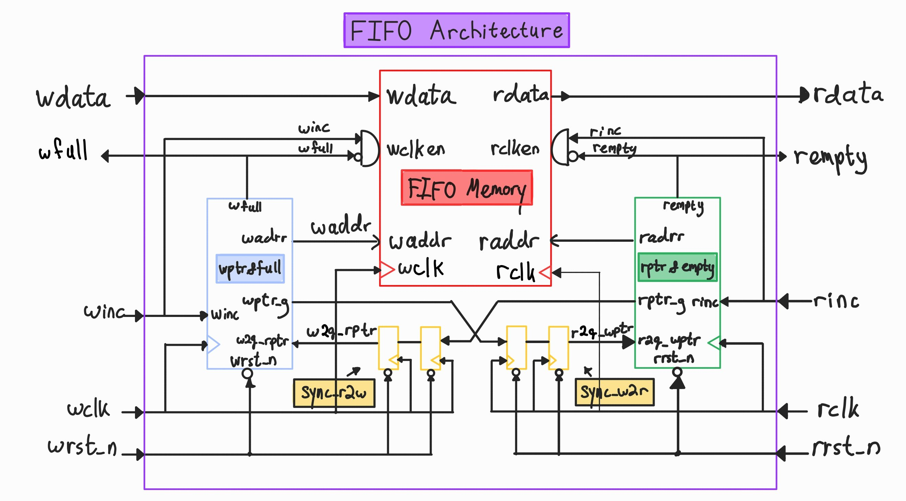
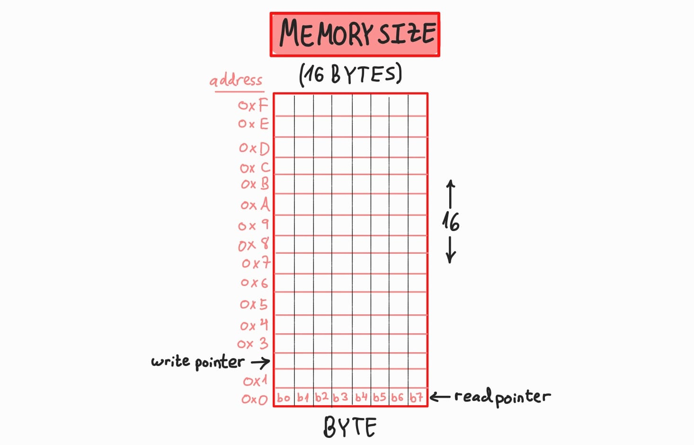

<!---

This file is used to generate your project datasheet. Please fill in the information below and delete any unused
sections.

You can also include images in this folder and reference them in the markdown. Each image must be less than
512 kb in size, and the combined size of all images must be less than 1 MB.
-->

## How it works

This is an Asynchronous FIFO (First-In First-Out) buffer designed to safely transfer 8-bit data words between two independent, unsynchronized clock domains without data corruption or loss. 

When a write operation occurs, data on `wdata` (`ui_in[7:0]`) is written into an internal dual-port RAM on the rising edge of the write clock. Simultaneously, data can be read from the RAM on the rising edge of the read clock and output to `rdata` (`uo_out[7:0]`). To safely coordinate between both domains without metastability, read and write pointers are converted to Gray code and passed through dual-flip-flop synchronizers.

### Architecture & Component Breakdown

The design consists of five core functional blocks:

1. **Dual-Port Memory Array (`fifo_mem.v`)**:
   - Organized as 16 entries of 8-bit registers.
   - Features independent write and read clocks, allowing simultaneous read and write operations at different clock rates.

2. **Write Pointer & Full Flag Generator (`fifo_w_ptr.v`)**:
   - Maintains a 5-bit binary write counter: the lower 4 bits index the 16 memory addresses, while the 5th MSB serves as the circular wrap indicator.
   - Converts the binary counter to Gray code so that only one bit toggles per increment.
   - Asserts `wfull` flag in the write domain when the write pointer has wrapped around once and matches the synchronized read pointer.

3. **Read Pointer & Empty Flag Generator (`fifo_r_ptr.v`)**:
   - Maintains a 5-bit binary read counter indexing the memory read port.
   - Converts the binary counter to Gray code for safe clock domain crossing.
   - Asserts `rempty` flag in the read domain whenever the read pointer catches up to the synchronized write pointer.

4. **2-Stage Flip-Flop Synchronizers (`fifo_synchronizer.v`)**:
   - Two synchronizer instances bridge the clock domains (write pointer $\rightarrow$ read domain, and read pointer $\rightarrow$ write domain).
   - Each synchronizer uses a 2-stage D-flip-flop shift register to resolve potential metastability before the pointers are evaluated.

5. **Top-Level ASIC Socket Wrapper (`tt_um_fifo.v`)**:
   - Maps the internal FIFO signals to Tiny Tapeout's 24-pin socket.
   - Drives `uio_oe = 8'b1100_0000` to configure pins `uio[5:0]` as input receivers and `uio[7:6]` as flag output drivers.
   - Implements active-low reset conditioning using De Morgan's Law to combine the global chip reset with domain-specific resets.

### Memory Size (16 Bytes Depth × 8-Bit Data Width)

### IO Pinout & Signal Mapping

The design interfaces with Tiny Tapeout's 24-pin socket (8 dedicated inputs, 8 dedicated outputs, and 8 bidirectional I/Os):

| Pin | Signal | Direction | Category | Description |
| :--- | :--- | :---: | :---: | :--- |
| **`ui_in[7:0]`** | `wdata[7:0]` | Input | Data | 8-bit Write Data Bus (bits 0–7) |
| **`uo_out[7:0]`** | `rdata[7:0]` | Output | Data | 8-bit Read Data Bus (bits 0–7) |
| **`uio[0]`** | `winc` | Input | Control | Write Increment / Enable (`1` = write on `wclk`) |
| **`uio[1]`** | `rinc` | Input | Control | Read Increment / Enable (`1` = read on `rclk`) |
| **`uio[2]`** | `wrst_n` | Input | Reset | Write Domain Reset (active-low) |
| **`uio[3]`** | `rrst_n` | Input | Reset | Read Domain Reset (active-low) |
| **`uio[4]`** | `wclk` | Input | Clock | Write Clock input |
| **`uio[5]`** | `rclk` | Input | Clock | Read Clock input |
| **`uio[6]`** | `wfull` | Output | Flag | FIFO Full status flag (`1` = full, `0` = available) |
| **`uio[7]`** | `rempty` | Output | Flag | FIFO Empty status flag (`1` = empty, `0` = has data) |
| **`rst_n`** | `rst_n` | Input | System | Global Hardware Reset (active-low) |
| **`ena`** | `ena` | Input | System | Chip Tile Enable (active-high) |

> **Bidirectional Pin Direction Control (`uio_oe`)**:  
> The output enable register is hardwired to `8'b1100_0000`. Pins `uio[5:0]` are set to Hi-Z (`0`) to act as input receivers for clocks, resets, and enables. Pins `uio[7:6]` are driven (`1`) as active push-pull outputs for the status flags.

## How to test

Testing on physical silicon is performed using the **Tiny Tapeout Demo Carrier Board**:

### 1. Manual Testing via Onboard DIP Switches & Buttons
1. **Power-On Reset**: Set `rst_n = 0`, `uio[2] = 0` (`wrst_n`), and `uio[3] = 0` (`rrst_n`).  
   - Verify `rempty` LED (`uio[7]`) lights **ON** (FIFO empty).  
   - Verify `wfull` LED (`uio[6]`) is **OFF** (not full).
2. **Release Reset**: Set `rst_n = 1`, `uio[2] = 1`, and `uio[3] = 1`.
3. **Write Data**:
   - Set 8-bit write data using the input DIP switches `ui_in[7:0]` (e.g. `0xA5`).
   - Set `uio[0] = 1` (`winc`).
   - Step / pulse the write clock `uio[4]` (`wclk`) high then low.
   - Set `uio[0] = 0` (`winc`).
   - Observe `rempty` LED (`uio[7]`) turns **OFF** (data is in FIFO).
4. **Fill to Capacity (16 Bytes)**:
   - Repeat write operations for 16 consecutive bytes.
   - On the 16th write, observe `wfull` LED (`uio[6]`) lights **ON** (FIFO full).
5. **Overflow Protection**:
   - Attempt a 17th write with `wfull = 1`.
   - Verify `wfull` remains asserted and stored data is preserved.
6. **Read Back Data**:
   - Set `uio[1] = 1` (`rinc`).
   - Step / pulse the read clock `uio[5]` (`rclk`) high then low.
   - Set `uio[1] = 0` (`rinc`).
   - Verify the written bytes appear on output LEDs `uo_out[7:0]` in strict First-In, First-Out order.
7. **Empty Return**:
   - After reading all 16 bytes, observe `rempty` LED (`uio[7]`) turns **ON** and `wfull` LED (`uio[6]`) turns **OFF**.

### 2. Automated Testing via Tiny Tapeout Web Commander
Connect the demo board via USB-C to a computer running Google Chrome and open the **[Tiny Tapeout Commander](https://commander.tinytapeout.com/)**:
1. Select project tile `tt_um_shlomo_fifo`.
2. Toggle input pins and clocks directly through the interactive web interface or send automated byte sequences.

## External hardware

None

### Links to GDS viewer and Explorer
https://gds-explorer.tinytapeout.com/viewer?file=https://shlomoabrams.github.io/tt-fifo/tinytapeout.oas&pdk=sky130A
https://gds-viewer.tinytapeout.com/?model=https://shlomoabrams.github.io/tt-fifo/tinytapeout.oas&pdk=sky130A